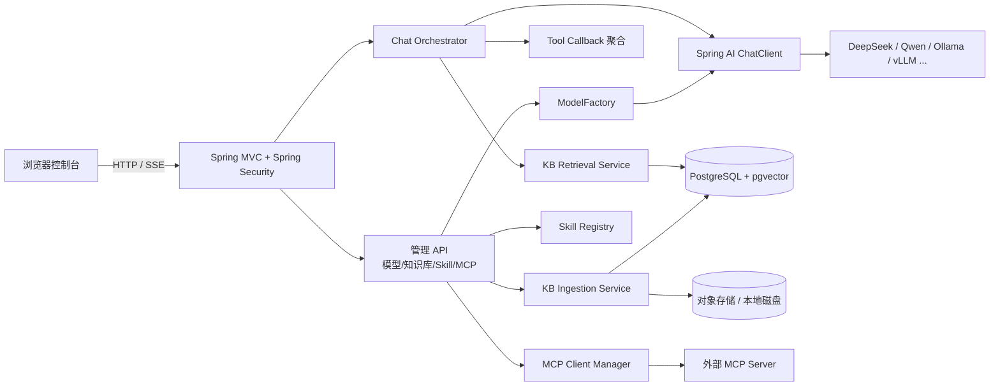
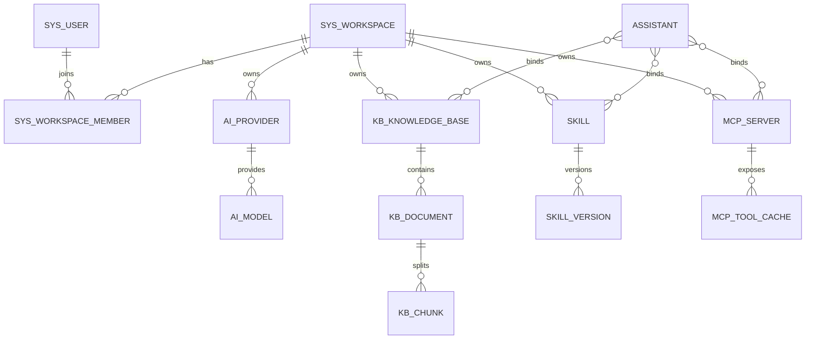
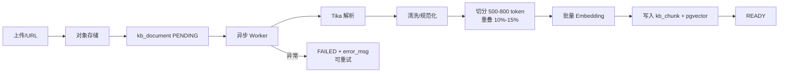
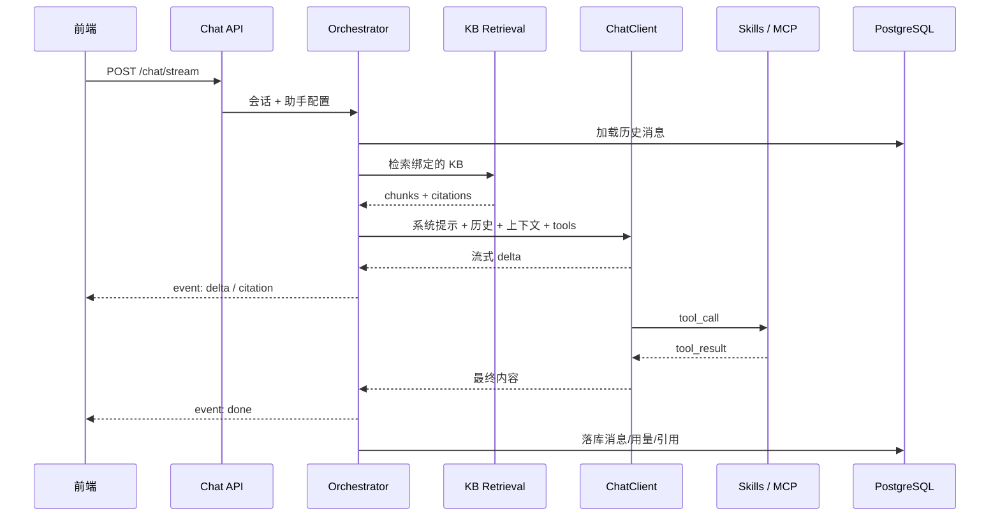

# Mate Agent Platform 架构设计与实施方案

> 基于 test-agent 演进的自建 Agent 基础平台
> 版本：v0.1（2026-11-05）
> 技术路线：Spring Boot 3.5 + Spring AI + PostgreSQL 16 + pgvector + 原生前端

---

## 1. 背景与目标

test-agent 目前是一个单体 Spring Boot 应用，已经验证了「多供应商对话 + SSE 流式 + 搜索注入 + Function Calling + 图片上传」的最小闭环。但它的配置来自 `application.yml`，会话与 Token 存在内存里，没有持久化、权限体系、知识库，也没有可扩展的工具/MCP 体系，无法直接承载平台级使用。

目标：在保留现有技术栈与前端资产的前提下，演进为一个可自建、可扩展的 Agent 基础平台，包含四个核心能力：

1. **知识库（Knowledge Base）**：文档接入、解析、切分、向量化、检索与对话引用（RAG）。
2. **模型配置（Model Config）**：供应商与模型的统一管理、连通性测试、按用途路由。
3. **Skill**：可复用的能力单元（提示词型 / 工具型 / 脚本包型），按助手绑定。
4. **MCP**：外部 MCP Server 的注册、连接、工具发现与调用。

MVP 非目标：计费、公网 SaaS 运营能力、复杂工作流编排引擎、图像/视频生成。

---

## 2. 现状评估：可复用与需替换

| 现有模块 | 现状 | 平台化处置 |
| --- | --- | --- |
| `AgentProperties` + `application.yml` | 多供应商配置，明文 Key | 迁移到数据库 + `ModelFactory`，密钥加密 |
| `ChatServiceImpl` | 手写 HTTP 调 `/chat/completions`，自实现工具轮次循环与流式拼接 | 改为 Spring AI `ChatClient`，保留 SSE 事件协议与轮次上限设计 |
| `ToolRegistry` | 两个硬编码工具（票房榜单/搜索） | 抽象为 Skill（TOOL 类型），票房工具作为第一个样例 |
| `SearchServiceImpl` | DuckDuckGo HTML 抓取 + 正则 | 改为可插拔网页搜索工具（可选启用），不再耦合进聊天主流程 |
| `AuthController` / `AuthFilter` | 内存 Token + 明文密码 | 替换为 Spring Security + 用户/空间/角色 + BCrypt |
| `UploadController` | 本地文件 + 全量 base64 返回 | 附件服务 + `ObjectStorage` 抽象（本地 FS → MinIO） |
| 静态页面（index/chat/boxoffice/login） | 原生 HTML/JS，深色设计 | 沿用视觉风格，扩展为管理控制台 |
| 日志 / 启动脚本 | 文件日志、硬编码 JDK 路径 | 保留日志方案，部署脚本改为环境变量 + Docker Compose |

**结论**：对话链路、SSE 协议、工具轮次控制、前端设计语言可以直接继承；配置、鉴权、存储、扩展机制需要重做。

---

## 3. 总体架构

### 3.1 架构图



### 3.2 模块划分（单工程、按领域分包）

MVP 保持**单可执行应用**，按领域分包，边界清晰；后续体量上来再拆 Maven 多模块。理由：当前团队/使用规模下，多模块只增加构建复杂度，不带来运行时收益。

```
vip.mate.agent
├── common        通用返回、异常、分页、加密、对象存储抽象
├── auth          用户、空间、成员、角色、Security 配置
├── model         供应商、模型、路由、ModelFactory、连通性测试
├── chat          会话、消息、编排、SSE、附件
├── kb            知识库、文档、切分、向量化、检索
├── skill         Skill 注册、版本、工具适配、测试
├── mcp           MCP Server 注册、客户端生命周期、工具缓存
├── assistant     助手配置（模型 + KB + Skill + MCP 的绑定单元）
└── web           REST 控制器与静态控制台
```

### 3.3 技术选型

| 层面 | 选型 | 说明 |
| --- | --- | --- |
| 语言/框架 | Java 25 + Spring Boot 3.5.x | 延续现有项目 |
| AI 框架 | Spring AI（2.x 版本线） | 使用官方 BOM；落地前按官方兼容矩阵锁定与 Boot 3.5 匹配的版本 |
| 对话能力 | Spring AI `ChatClient` + `ToolCallback` | 统一工具调用、流式输出、结构化输出 |
| 嵌入/向量 | Spring AI `EmbeddingModel` + pgvector store | 免引入独立向量数据库 |
| 数据库 | PostgreSQL 16 + pgvector | 业务数据、向量、全文检索同库 |
| 迁移 | Flyway | 版本化 DDL |
| ORM | Spring Data JPA | 与 Spring 生态一致，开发效率高 |
| 鉴权 | Spring Security（Session Cookie） | 浏览器端同源，避免 Token 放 localStorage |
| 文档解析 | Apache Tika | 覆盖 PDF/Word/HTML/Markdown |
| 部署 | Docker Compose | app + pgvector 镜像 + 卷 |
| 前端 | 原生 HTML/JS + fetch | 沿用现有设计系统，不引入框架 |

---

## 4. 领域模型与数据库设计

### 4.1 多租户策略

- 所有业务资源表带 `workspace_id`，服务层从会话上下文取当前空间，所有查询强制过滤。
- 平台管理员可创建**全局资源**（`workspace_id = NULL`），如内置 Skill、公共模型模板；空间内资源不可跨空间读取。
- 服务层统一封装 `WorkspaceGuard.requireAccess(workspaceId, user)`，禁止依赖前端传参做权限判断。
- Phase 4 可选启用 PostgreSQL RLS 作为纵深防御，MVP 不做。

### 4.2 表设计

**认证与空间**

| 表 | 关键字段 | 说明 |
| --- | --- | --- |
| `sys_user` | id, username, password_hash, nickname, status, created_at | 用户 |
| `sys_workspace` | id, name, slug, owner_id, status, created_at | 工作空间 |
| `sys_workspace_member` | id, workspace_id, user_id, role, created_at | role: OWNER/ADMIN/MEMBER |
| `sys_audit_log` | id, workspace_id, user_id, action, resource_type, resource_id, detail_json, created_at | 配置变更审计 |

**模型配置**

| 表 | 关键字段 | 说明 |
| --- | --- | --- |
| `ai_provider` | id, workspace_id, name, type, base_url, api_key_cipher, headers_json, enabled, timestamps | type: OPENAI_COMPATIBLE / ANTHROPIC / 自定义 |
| `ai_model` | id, provider_id, model_key, display_name, capabilities_json, context_window, default_params_json, enabled | capabilities: CHAT/VISION/REASONER/EMBEDDING/RERANK |
| `ai_model_route` | id, workspace_id, purpose, model_id | purpose: CHAT/REASONER/VISION/EMBEDDING/RERANK/FAST，唯一约束 (workspace_id, purpose) |

**对话**

| 表 | 关键字段 | 说明 |
| --- | --- | --- |
| `chat_session` | id, workspace_id, user_id, assistant_id, title, model_snapshot, params_json, created_at, updated_at | 会话 |
| `chat_message` | id, session_id, role, content, tool_calls_json, tool_call_id, model, prompt_tokens, completion_tokens, citations_json, created_at | 消息与用量 |
| `chat_attachment` | id, message_id, object_key, mime, size | 图片/附件 |

**知识库**

| 表 | 关键字段 | 说明 |
| --- | --- | --- |
| `kb_knowledge_base` | id, workspace_id, name, description, embedding_model_id, chunk_size, chunk_overlap, retrieval_json, status | 一个 KB 绑定一个嵌入模型 |
| `kb_document` | id, kb_id, workspace_id, name, source_type, object_key, mime, size, checksum, status, error_msg, metadata_json | status: PENDING/PARSING/PARSED/EMBEDDING/READY/FAILED |
| `kb_chunk` | id, kb_id, document_id, seq, content, token_count, metadata_json | 切分结果，metadata 含页码/标题 |
| `kb_embedding` | chunk_id, embedding vector(N) | 由 Spring AI pgvector store 管理或自建表 |

> 维度约束：pgvector 列长度固定。MVP 建议平台统一默认嵌入模型（如 1024 或 1536 维），一个 KB 创建时锁定模型；多维度并存放到 Phase 4（按维度分表/分 collection）。

**Skill 与助手**

| 表 | 关键字段 | 说明 |
| --- | --- | --- |
| `skill` | id, workspace_id, name, type, description, manifest_json, enabled, created_at | type: PROMPT/TOOL/PACKAGE；workspace_id NULL 表示内置 |
| `skill_version` | id, skill_id, version, content_md, files_json, entry_config_json, created_at | 版本不可变，可回滚 |
| `assistant` | id, workspace_id, name, description, system_prompt, params_json, enabled | 对话配置单元 |
| `assistant_skill` | assistant_id, skill_id, config_json | 绑定 Skill |
| `assistant_kb` | assistant_id, kb_id | 绑定知识库 |
| `assistant_mcp` | assistant_id, mcp_server_id | 绑定 MCP Server |

**MCP**

| 表 | 关键字段 | 说明 |
| --- | --- | --- |
| `mcp_server` | id, workspace_id, name, transport, command, args_json, url, headers_json, env_cipher_json, enabled, status, last_check_at | transport: STDIO/SSE/STREAMABLE_HTTP |
| `mcp_tool_cache` | id, server_id, tool_name, description, input_schema_json, discovered_at | 唯一约束 (server_id, tool_name) |

### 4.3 核心关系



### 4.4 初始化

- Flyway 迁移：`V1__init.sql`（认证/空间）、`V2__model.sql`、`V3__chat.sql`、`V4__kb.sql`、`V5__skill_assistant.sql`、`V6__mcp.sql`。
- 种子数据：管理员账号（密码来自环境变量，首次启动生成并打印一次）、默认空间、内置票房 Skill。

---

## 5. 核心模块设计

### 5.1 模型配置

**结构**：Provider → Model → Route。

- Provider 支持 `OPENAI_COMPATIBLE`（DeepSeek、Qwen、Ollama、vLLM 等），后续可扩展 Anthropic。
- Model 携带能力标签与默认参数；Route 决定每种用途用哪个模型。
- `ModelFactory` 按 Provider 配置构建 `ChatModel`/`EmbeddingModel` 实例并缓存；配置变更发布 `ModelConfigChangedEvent` 清除对应缓存。
- 连通性测试：`POST /api/v1/providers/{id}/test`，优先调用 `/models`，失败则做一次极短对话，返回耗时与错误原因。
- API Key 使用 AES-GCM 加密存库，主密钥来自环境变量 `APP_SECRET_KEY`；任何接口只返回掩码（`sk-****abcd`）。
- **兼容性注意**：DeepSeek 的 reasoning 字段、Qwen 的视觉 content array、各家流式 tool_calls 分片格式存在差异。`ModelFactory` 预留自定义适配层；现有 `ChatServiceImpl` 中处理视觉模型与工具分片拼接的逻辑可作为参考实现保留。

### 5.2 知识库与 RAG

**接入流水线**



- 状态机：`PENDING → PARSING → PARSED → EMBEDDING → READY / FAILED`。
- 支持格式：PDF / DOCX / MD / TXT / HTML；默认单文件 20MB、页数上限可配。
- 去重：按 `checksum` 判定；重新索引前删除旧 chunk 与向量，保证幂等。
- 异步：MVP 用 Spring `@Async` + 有界线程池；Phase 4 再引入任务表/队列，避免重启丢任务。
- 检索：query 嵌入 → 按 KB 过滤的相似度 top-k（余弦）→ 可选重排 → 取 top-N（默认 5）→ 组装上下文与引用。
- 混合检索（Phase 2）：PostgreSQL 全文检索（tsvector）+ 向量结果 RRF 融合，显著改善关键词类查询。
- 引用：每个 chunk 返回 `documentName`、`seq/page`、`snippet`；SSE 增加 `citation` 事件，同时落库 `chat_message.citations_json`，前端可点击定位。

### 5.3 Skill 体系

三种类型，覆盖从轻到重：

| 类型 | 形态 | 执行方式 | 适用 |
| --- | --- | --- | --- |
| PROMPT | SKILL.md + 参考资料 | 拼接进系统提示，不执行代码 | 角色设定、写作规范、领域知识 |
| TOOL | 参数 Schema + Java 实现 | 注册为 Spring AI `ToolCallback` | 票房查询、网页搜索、HTTP 调用 |
| PACKAGE（Phase 4） | SKILL.md + scripts + assets | 受限沙箱中执行 | 兼容现有 `.codebuddy/skills` 打包格式 |

- 注册来源：内置（代码注册、只读）+ 空间自建（DB 管理）。
- 版本不可变，可按版本回滚；对话引用具体版本，保证可复现。
- 控制台提供测试面板：PROMPT 类预览注入效果；TOOL 类支持试运行与参数校验。
- 迁移样例：把现有票房 `ToolRegistry` 改造为第一个内置 TOOL Skill，验证注册、绑定、调用、错误处理全链路。
- PACKAGE 类涉及任意代码执行，必须管理员权限、命令白名单、超时与资源限制，默认关闭。

### 5.4 MCP

- 支持 `STDIO` / `SSE` / `STREAMABLE_HTTP` 三种传输。
- 客户端生命周期：启动时连接启用的 Server；懒连接 + 健康检查 + 自动重连；工具清单缓存到 `mcp_tool_cache`，支持手动刷新。
- 对话集成：按 assistant 绑定的 MCP Server，将远程工具适配为 `ToolCallback`；工具名加前缀 `mcp__{server}__{tool}` 防冲突；调用超时与失败降级为工具错误消息，不中断对话。
- 安全约束：
  - STDIO 仅平台管理员可配置，命令白名单 + 环境变量最小化；
  - 远程地址可选 allowlist；
  - 凭据加密存储，审计所有变更；
  - 工具调用设置超时与最大返回长度。
- Phase 4 可选：平台自身作为 MCP Server，对外暴露知识库检索/对话能力。

### 5.5 对话编排



**SSE 事件协议**（在现有基础上扩展，保持兼容）：

| event | data | 说明 |
| --- | --- | --- |
| `search` | 搜索结果 JSON | 保留（网页搜索工具启用时） |
| `delta` | 文本片段 | 增量内容 |
| `tool_call` | 工具名 + 参数 | 工具调用开始 |
| `tool_result` | 工具名 + 结果 | 工具执行结果 |
| `citation` | 文档名 + 片段 + 定位 | 知识库引用 |
| `done` | model + usage | 结束 |
| `error` | 错误信息 | 异常 |

- 工具轮次上限沿用 5 轮。
- 编排器负责历史裁剪（按 token 预算）与系统提示组装，不把业务逻辑散落在 Controller。

---

## 6. API 设计（概要）

统一前缀 `/api/v1`，统一响应 `{ code, message, data }`，分页 `page/size`。

| 分组 | 接口 |
| --- | --- |
| 认证 | `POST /auth/login`、`POST /auth/logout`、`GET /auth/me`、`GET /auth/csrf` |
| 空间 | `GET/POST /workspaces`、`GET/PUT/DELETE /workspaces/{id}`、成员 CRUD |
| 用户 | `GET/POST /users`（管理员）、`PUT /users/{id}/password` |
| 模型 | `GET/POST /providers`、`PUT/DELETE /providers/{id}`、`POST /providers/{id}/test`、模型 CRUD、`GET/PUT /model-routes` |
| 知识库 | `GET/POST /kb`、`GET/PUT/DELETE /kb/{id}`、`POST /kb/{id}/documents`、`GET /documents/{id}`、`POST /documents/{id}/reindex`、`POST /kb/{id}/search`（检索调试） |
| 对话 | `GET/POST /chat/sessions`、`GET /chat/sessions/{id}/messages`、`POST /chat/stream`、`POST /chat` |
| Skill | `GET/POST /skills`、`PUT/DELETE /skills/{id}`、`GET/POST /skills/{id}/versions`、`POST /skills/{id}/test` |
| 助手 | CRUD `/assistants`，绑定 KB/Skill/MCP |
| MCP | `GET/POST /mcp/servers`、`PUT/DELETE /mcp/servers/{id}`、`POST /mcp/servers/{id}/connect`、`POST /mcp/servers/{id}/refresh`、`GET /mcp/servers/{id}/tools` |
| 运维 | `GET /actuator/health`、`GET /audit-logs` |

---

## 7. 鉴权与安全

- **认证**：Spring Security Session Cookie（HttpOnly、SameSite=Lax）+ CSRF Token；浏览器同源使用，避免 localStorage 存 Token。后续可补 API Key 供程序调用。
- **密码**：BCrypt；登录失败限速；默认账号首次启动强制改密。
- **授权**：平台管理员 + 空间 OWNER/ADMIN/MEMBER；服务层统一校验，越权返回 404 避免资源探测。
- **密钥**：数据库密文存储，主密钥来自环境变量，接口输出掩码；日志禁止打印 Key。
- **上传**：Tika 嗅探真实类型，限制大小，随机对象名，下载走鉴权接口，文件不对外直出。
- **MCP**：STDIO 命令白名单、管理员专属；远程工具结果截断；全量审计。
- **审计**：模型配置、密钥变更、MCP 接入、Skill 发布均写审计表。

---

## 8. 前端控制台

沿用现有深色设计系统（CSS 变量、玻璃拟态），MVP 不引入框架：

| 页面 | 功能 |
| --- | --- |
| `login.html` | 登录（保留，接入新认证） |
| `index.html` | 控制台外壳（保留侧边栏 + iframe，扩展导航） |
| `chat.html` | 对话（改造：助手/模型选择、KB/Skill/MCP 开关、引用展示） |
| `models.html` | 供应商与模型管理、连通性测试、路由配置 |
| `kb.html` | 知识库列表、详情、上传、文档状态、检索调试 |
| `skills.html` | Skill 列表、编辑器、测试面板 |
| `mcp.html` | MCP Server 管理、连接状态、工具清单 |
| `settings.html` | 用户与空间成员管理 |

---

## 9. 迁移路径

1. **基座改造**：引入 PG/Flyway/Security，保持旧功能可用，短暂双轨。
2. **配置迁移**：`agent.providers` → `ai_provider`/`ai_model`/`ai_model_route`，删除 yml 明文 Key。
3. **对话改造**：`ChatServiceImpl` → `ChatOrchestrator` + `ChatClient`，保留 SSE 事件与前端兼容。
4. **工具迁移**：`ToolRegistry` → Skill 框架，票房工具作为内置样例；搜索改为可选工具。
5. **鉴权替换**：内存 Token → Spring Security + 用户/空间。
6. **新增知识库**：上传、解析、向量化、检索、引用。
7. **新增 MCP**：注册、连接、工具发现、绑定。
8. **控制台扩展**：按模块交付页面。

---

## 10. 工程结构与依赖

```
src/main/java/vip/mate/agent/
├── AgentPlatformApplication.java
├── common/        Result, ErrorCode, PageResult, CryptoService, ObjectStorage, WorkspaceGuard
├── auth/          SecurityConfig, User, Workspace, Member, AuthController
├── model/         Provider, Model, ModelRoute, ModelFactory, ProviderController
├── chat/          Session, Message, ChatOrchestrator, SsePublisher, ChatController
├── kb/            KnowledgeBase, Document, Chunk, IngestionService, RetrievalService, KbController
├── skill/         Skill, SkillVersion, SkillRegistry, ToolSkillAdapter, SkillController
├── mcp/           McpServer, ClientManager, ToolCache, McpController
├── assistant/     Assistant, Binding, AssistantController
└── web/           static/*
```

新增依赖（版本以 Spring AI 官方 BOM 与 Boot 3.5 兼容矩阵为准）：

```xml
spring-boot-starter-web / security / validation / data-jpa / actuator
spring-ai-bom
spring-ai-starter-model-openai
spring-ai-starter-vector-store-pgvector
spring-ai-starter-mcp-client
flyway-core, flyway-database-postgresql, postgresql
tika-core, tika-parsers-standard-package
lombok（已有）, spring-boot-starter-test（已有）
testcontainers-postgresql, wiremock（测试用）
```

> 实施前先锁定 Spring AI BOM 版本并用一个最小用例验证：自定义 base_url 的 OpenAI 兼容调用、pgvector 读写、MCP 连接。三者跑通再铺开业务。

---

## 11. 里程碑与工作量

| 阶段 | 内容 | 交付物 | 预估 |
| --- | --- | --- | --- |
| P0 基座 | Security + 用户/空间 + Flyway + 模型配置 + 对话迁 DB | 可登录、可配模型、对话正常 | 3-5 天 |
| P1 知识库 | 上传/解析/切分/向量化/检索/引用 + 管理页 | KB 全链路可用 | 5-8 天 |
| P2 Skill | Skill 模型 + 注册 + 内置票房迁移 + 绑定 + 测试面板 | 工具可配置化 | 3-5 天 |
| P3 MCP | Server 管理 + 客户端生命周期 + 工具发现/调用 | 外部 MCP 工具可用 | 3-5 天 |
| P4 加固 | 异步任务表、审计、限流、可观测、Docker、测试 | 可部署验收 | 5-8 天 |

单人全职约 4-6 周；若多人并行（后端/前端/知识库），可压缩到 3 周左右。每一阶段结束都应保持应用可运行。

---

## 12. 风险与对策

| 风险 | 影响 | 对策 |
| --- | --- | --- |
| Spring AI 版本与 Boot 3.5 兼容性 | 启动/依赖冲突 | 先做最小验证工程，锁定 BOM；必要时保留自研 OpenAI 兼容客户端 |
| 不同供应商流式/工具协议差异 | 工具调用或视觉不可用 | ModelFactory 留适配层，参考现有 ChatServiceImpl 的兼容处理 |
| 嵌入维度不一致 | pgvector 写入失败 | KB 锁定单一嵌入模型；多维度延后，按维度分表 |
| 文档解析质量（扫描件/复杂版式） | 检索效果差 | 明确支持格式；扫描件 OCR 列为后续；保留原始文件可重跑 |
| MCP STDIO 任意命令执行 | 主机安全风险 | 管理员专属 + 白名单 + 环境隔离 + 审计 |
| 知识库异步任务重启丢失 | 文档卡在中间态 | MVP 重启后扫描非终态文档重新入队；Phase 4 换队列 |
| 范围膨胀 | 交付延期 | 严格按 MVP 非目标裁剪，每阶段可运行 |

---

## 13. 验收标准

- **模型配置**：新增 DeepSeek/Qwen 供应商并测试连通；切换路由后对话生效；Key 不出现在接口与日志中。
- **知识库**：上传 PDF/MD 后在状态页可见 READY；检索调试返回相关片段；对话回答带可点击引用；失败文档可重试。
- **Skill**：控制台启用/停用工具型 Skill；对话中模型可调用票房工具并返回结构化结果；提示词型 Skill 生效。
- **MCP**：接入一个官方示例 MCP Server，工具清单可见；对话中可触发其工具并拿到结果；断开后降级不报 500。
- **平台基础**：两个空间数据互不可见；未登录访问 API 返回 401；审计表记录配置变更；`docker compose up` 一键启动。
